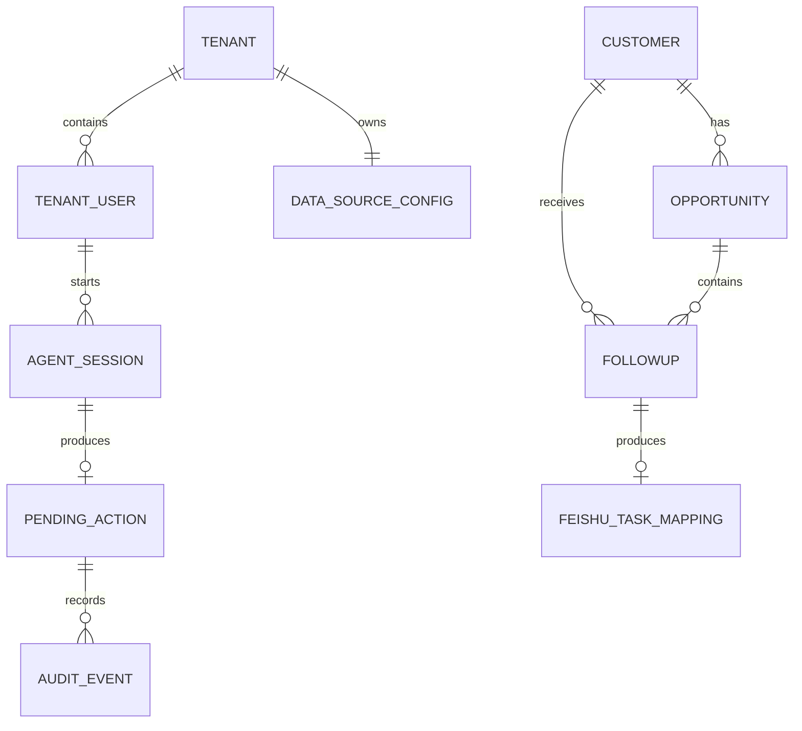
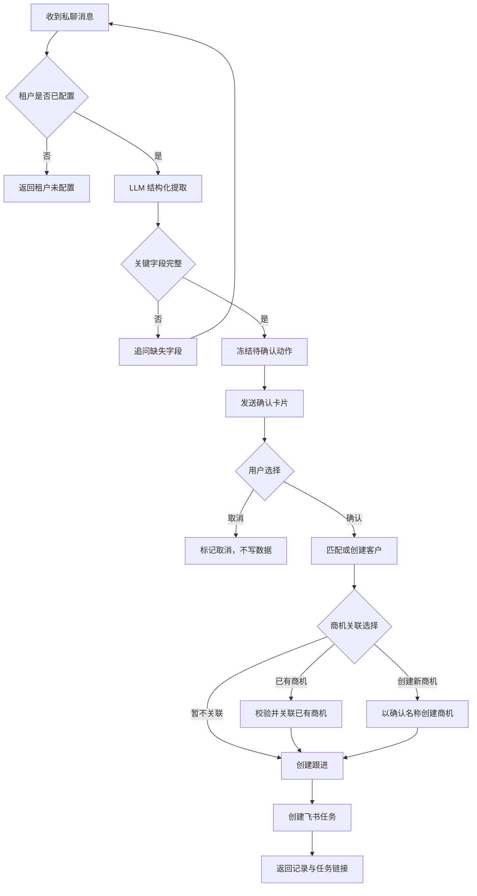
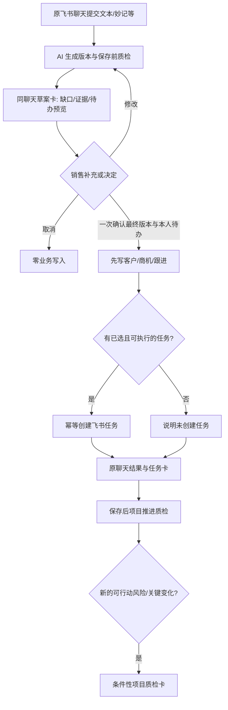

# 业务架构

## 客户沟通准备包 Goal v1（2026-10-19）

已确认启动，执行设计见 [SDD 49](specs/49-customer-preparation-chat-sdd.md)。先请求边界、客户解析与独立多轮状态，再组合既有服务接聊天和 Web。仅生成建议，权限/来源/幂等/人工边界不变；真实消息与业务写入不增加。当前实现中，不宣称可用。

## 到期提醒结果名称（2026-10-19）

到期稍后提醒使用简短按钮标签，结果不能显示“标记已处理：稍后提醒”。仅当通知 subjectKey 精确等于事项 ID 且只有一个事项范围时，使用冻结通知首个 section 的事项标题；其他通知沿用原标签后缀剥离，不猜测跨事项名称。回调、状态版本、投递键不变，先以真实 reminder planner 产物建立失败测试，再修复。跨日失效版本不迁移提醒，真实发送与业务写入额度不增加。

## 今日行动建议证据边界（2026-10-18）

商机建议动作与建议日期必须有非空且全部可解析的本商机 evidenceIds，不能只校验提醒原因的证据。建议引用为空或缺失时，保留有证据的提醒原因，建议降级为“核实并补充商机信息”，时间使用本次参考日；来源覆盖标记 partial 并提示建议未采用。不新增 Agent、外部写入或权限；不扩大来源读取范围。先补无引用、部分缺失与完整有效建议测试，再实现并验证。五类真实样本和聊天验收缺口仍独立保留。

## 聊天行动结果文案纠正（2026-10-18）

真实稍后提醒回显误用了同一事项第一个快捷按钮的标签，出现“标记已处理：稍后提醒”。结果应只展示事项名称和持久化实际状态，剥离已知操作后缀；保留名称内部标点和未识别标签，不改变回调参数、归属、版本、幂等键或其他事项入口。先以四种按钮顺序与名称含分隔符的失败用例验证，再修复并运行相关测试、类型/Lint/构建。真实卡片更新仍受现有授权额度约束，不为纯展示修复新增发送。

## 今日行动限定验收发送设计（2026-10-18）

新增独立手动入口，默认仅预览，显式send才投递；不调用整批run、不启用或改变定时配置。必须同时匹配现有租户/成员/收件人白名单、有效本人会话及customer/opportunity/task读取权限，且会话tenant/member/openId与白名单一致。按明确的1至2个事项ID从本人实时报告中选取，每项标题必须含完整TCL-UAT-YYYYMMDD标记，任何缺失、重复、非open或标记不符整批拒绝。只读取选中事项控制状态，不将历史事项、来源告警原文或其他报表纳入卡片。

复用今日行动卡片四操作、首次payload冻结、投递审计/重试/unknown保护；手动请求以稳定runKey和范围摘要绑定通知键，不用时间戳制造新键。预览返回将发送的卡片，发送最多一张；相同runKey始终占用同一投递槽；重试只使用账本冻结的首次payload，已发送或unknown不重新投递。不写Base/Task，不绕过卡片归属核验。真实场景仅使用剩余4条消息额度，业务额度2跟进/3任务不增加。

TDD覆盖：默认预览零投递；精确过滤且不泄漏历史；空/重复/缺失/非测试/非open拒绝；跨租户/成员/收件人、缺权拒绝；每次最多一张且键稳定；复用现有delivery的重复与unknown集成覆盖。完成后运行单元/集成/类型/Lint/双构建及真实卡片验收，缺样本单独阻塞。

2026-10-18增量：今日事项快捷创建任务由完整表单一次确认，失败保留原操作键恢复，结果查询不得触发执行。跟进工作台遵守D-052，须同时创建完整本人待办，缺少时确认前阻断；不提供只保存跟进。真实任务测试额度已达2/2，后续写入需另行确认。

> 第 1–6 节记录 P0 已验证流程；Goal v3 的最新顺序、条件卡片和一次确认任务授权见
> 第 7 节与 [决策问答](decisions/2026-09-20-followup-chat-cards.md)。保留旧流程供回归，
> 不把它当作新版聊天卡片的完成证据。
> 普通聊天与跟进的前置意图分流、质量反馈新口径见
> [对话与质检决策](decisions/2026-09-20-conversation-and-quality.md)。

## 1. P0 业务对象



| 对象 | 定义 | P0 存储位置 |
| --- | --- | --- |
| 租户 | 一个飞书企业安装实例 | Agent 数据库 |
| 租户用户 | 当前企业中的飞书用户 | Agent 数据库最小映射 |
| 数据源配置 | 租户对应的 Base、表和字段映射 | Agent 数据库 |
| Agent 会话 | 多轮补全所需的短期上下文 | Agent 数据库 |
| 待确认动作 | 卡片展示的不可变业务草案 | Agent 数据库 |
| 客户 | 被销售推进的企业客户 | 多维表格 |
| 商机 | 围绕客户的一次销售机会 | 多维表格 |
| 跟进 | 一次沟通的原文、事实和下一步 | 多维表格 |
| 飞书任务映射 | 跟进与真实任务的对应关系 | Agent 数据库 |
| 审计事件 | 模型、确认、工具调用和终态记录 | Agent 数据库 |

## 2. Demo Base

P0 创建一个名为“销售 Agent Demo 数据”的多维表格，包含三个表。

### 客户

| 字段 | 类型 | 用途 |
| --- | --- | --- |
| 客户名称 | 文本，主字段 | 客户匹配键 |
| 行业 | 单选 | 模拟客户画像 |
| 规模 | 单选 | 模拟客户画像 |
| 联系人 | 文本 | 关键联系人 |
| 客户负责人 | 人员 | 当前销售 |
| 最近跟进时间 | 日期时间 | 判断活跃度 |
| 数据状态 | 单选 | 正常或演示 |

### 商机

| 字段 | 类型 | 用途 |
| --- | --- | --- |
| 商机名称 | 文本，主字段 | 销售确认的明确项目或采购机会名称 |
| 客户 | 关联客户表 | 商机归属 |
| 阶段 | 单选 | 需求发现、方案验证、方案提交、商务谈判、赢单、输单 |
| 预计金额 | 数字 | 商机规模 |
| 商机负责人 | 人员 | 当前销售 |
| 当前进展 | 多行文本 | 已确认事实摘要 |
| 下一步 | 多行文本 | 待执行动作 |
| 下一步截止时间 | 日期时间 | 创建任务依据 |
| 风险 | 多行文本 | 已确认或待验证风险 |
| 最近跟进时间 | 日期时间 | 最后活动时间 |

### 跟进

| 字段 | 类型 | 用途 |
| --- | --- | --- |
| 跟进标题 | 文本，主字段 | 客户名 + 日期 |
| 客户 | 关联客户表 | 客户关系 |
| 商机 | 关联商机表，可空 | 仅在销售确认已有或新建商机时关联 |
| 原始文本 | 多行文本 | 审计证据 |
| 沟通摘要 | 多行文本 | 用户确认后的摘要 |
| 客户需求 | 多行文本 | 明确需求 |
| 异议与风险 | 多行文本 | 异议和风险 |
| 下一步 | 多行文本 | 计划动作 |
| 截止时间 | 日期时间 | 任务期限 |
| 跟进人 | 人员 | 消息发送者 |
| 确认状态 | 单选 | 已确认、已取消 |
| 消息 ID | 文本 | 消息级幂等与追溯 |

实际创建前必须根据 Base 返回的真实字段和表 ID 建立配置，代码不得猜测 ID。

## 3. 主业务流程



## 4. 匹配与写入规则

### 客户匹配

- P0 使用规范化后的客户名称精确匹配。
- 同名多条时不自动选择，返回冲突并要求人工处理。
- 没有匹配项时，确认动作中明确显示“将创建新客户”。

### 商机匹配

- 跟进必须关联客户，但可以暂不关联商机。
- AI 只在同一客户的本人可读商机中提出候选；唯一名称精确匹配时可预选已有商机。
- 明确商机名没有匹配时可预选“创建新商机”，但必须由销售在确认卡提交。
- 没有明确项目或多个候选无法唯一确定时默认暂不关联，不能猜测或创建占位商机。
- 禁止生成“客户名 - 销售机会”等泛化名称。

### 跟进写入

- 每次确认创建一条跟进，不覆盖原始证据。
- `message_id` 和租户共同构成业务幂等键；不能使用可能随重投变化的 `event_id`。
- AI 推断和用户明确事实分开保存；未确认推断不得写为客户事实。

### 任务创建

- 任务标题使用结构化“下一步”。
- 负责人默认当前用户。
- 截止时间来自用户文本或补充回答。
- 描述中包含客户、跟进摘要和 Base 记录引用；有商机关联时再包含商机。
- 任务创建成功后保存飞书任务 GUID，重试时先检查映射。

## 5. 多租户规则

- 飞书 `tenant_key` 只能映射到一个内部 `tenant_id`。
- 任何仓储查询都必须显式携带 `tenant_id`。
- Base token、表 ID、字段映射和凭证引用按租户保存。
- 缓存键、会话键、事件幂等键和任务映射均以租户作为前缀。
- 不允许用客户端提交的 `tenant_id` 覆盖事件解析结果。
- 测试必须证明租户 A 无法读取、确认或重试租户 B 的动作。

## 6. 失败补偿

- LLM 失败：不产生待确认动作，提示用户稍后重试。
- Base 全部写入失败：动作标记失败，可安全重试。
- Base 部分成功：记录已创建的 record ID，只补做剩余步骤。
- 飞书任务失败：保留已确认的 Base 数据，并提供只重试任务的入口。
- 卡片重复点击：返回原终态，不重复执行。
- 超时或无权限：记录明确错误类别，不把失败描述成成功。

## 7. Goal v3 保存前质检与任务一次确认



- 保存前任务候选只供预览；用户一次确认同时授权写入和创建**卡中所示、已选择**的本人待办。
  候选随草案版本变化，旧卡不能确认新版本；其他人负责的任务另行核权和明确确认。
- Base 未写成功不能创建任务。Base 已写、Task 失败时展示部分失败并只补建该任务；结果
  回到提交会话，不能把部分成功写成全成功。无明确下一步/截止时间时不编造任务。
- 内容质量与项目健康分离。项目风险及需求的跨角色推送只基于已确认事实，按租户策略、
  收件人数据权限、证据和去重发送。日报周报、到期提醒使用独立的定时/状态事件。

## 8. 对话入口前置业务规则

```text
私聊消息 -> 租户/用户/消息去重 -> 意图与上下文
  -> 聊天/销售建议/内容草稿：仅回复，无业务副作用
  -> 查询：仅用授权事实源；未接通不编造
  -> 歧义：澄清记录还是分析
  -> 明确跟进：沿用第 7 节草案/确认/写入/任务闭环
```

明确“写跟进”打开表单；“记一条跟进：……”可直接形成草案；“张总说预算下周批”
不能默认授权录入。跟进补充会话只在原聊天有效，换话题不能把新的问答并入客户原文。
默认卡片不展示旧质量数字和等级，只显示阻断项、建议补充及本人任务预览。

## 2026-10-16 今日行动闭环
事项 = 明确来源信号 + 判断证据 + 原因 + 建议动作/时间。本人处理状态不改变业务事实；新证据产生新版本。跟进与任务操作必须进入现有人工确认流程。详见 specs/47-trusted-followup-action-center-sdd.md。

2026-10-16 今日行动卡片边界：快捷操作仅能处理认证销售本人当前可见事项；接收人、事项版本与修订必须一致。稍后提醒和已处理进入状态账本，生成跟进与创建任务进入人工确认，不直接写业务数据。

### 卡片状态回显恢复切片（2026-10-17）
- 设计：基于已发送卡片冻结载荷与当前事项状态生成原卡片替换内容；保留其他事项与工作台入口，已处理/稍后提醒事项移除旧操作按钮。
- 恢复：回调重试重放持久操作结果，再按最新状态重建卡片；不新增消息、不重复业务写入。卡片返回失败仅影响展示，保留原操作键供重试。
- 验收：状态渲染覆盖多事项、旧版本隔离和重复重建；真实卡片展示仍待真实账号验收。

### 到期提醒调度切片（2026-10-17）
- 到期提醒沿用现有单租户、单成员、单收件人 rollout 与发送开关；task_action 启用时，在每次调度读取到期 snoozed 状态。
- 重新读取可见事项并精确匹配版本；事项失效、来源不可用或已处理时不发送。投递键由事项 ID、版本与状态 revision 组成，失败重试不提前消费提醒，未知投递由现有账本冻结。
- 普通每日摘要过滤已处理和稍后提醒事项，避免绕过提醒时间。每条提醒包含原因、证据、建议动作与完成日期。
- 验收先覆盖纯规划去重、过期版本和未到期过滤，再接生产调度并验证模块装配；真实发送单独确认。

### 完整行动摘要切片（2026-10-17）
- 飞书每日 task_action 摘要复用 TodayActionService，覆盖客户跟进、任务与商机信号，并读取持久状态过滤已处理/稍后提醒项。
- 每条展示原因、证据、建议动作、建议完成日期；来源降级明确显示。保持本人权限、现有 rollout、投递幂等与人工确认边界。
- 本切片先测试摘要内容与状态过滤，再接生产 runner；聊天业务草案快捷操作继续单独实现，不直接写业务数据。

### 聊天独立任务确认卡切片
创建任务快捷操作先生成本人可编辑草案，完整展示标题、截止时间、执行方式和参与人。确认回调携带 action ID 与版本；严格验证表单、身份、原卡片及租约后才调现有独立任务执行器。过期、重复、旧版本与失败恢复沿用持久状态边界。真实任务创建单独确认，开发验证不调用外部写入。

### Web 任务执行结果查询切片
新增本人任务草案只读状态查询，返回等待确认、执行中、成功或失败及原任务链接。服务端检查 task:read、本人归属与 task 类型；客户端不得通过确认接口轮询，避免读操作触发重试。后续工作台保存 action ID 并短轮询，失败显式重试原 action。
