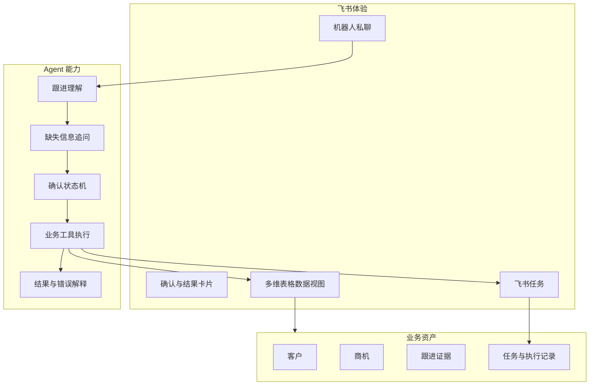

# 产品架构

PLAYBOOK-DRAFT（2026-10-20，已实现）：接受候选后的版本化草稿、历史与冲突恢复已通过自动化和合成组件验证，真实登录 UAT 待补，见 [SDD 51](specs/51-playbook-authoring-sdd.md)。草稿不发布、不进入正式检索；采用统计和赢丢单发现另列。

PREP-WEB-ENTRY（2026-10-20，已实现）：独立工作台根路径、查询入口及结果深链刷新加载 Agent 页面；HTTP 16/16 与内置浏览器身份提示验证通过。有身份的完整结果验收仍待完成。

PREP-CONTENT 验收补充（2026-10-20）：进行中或状态未知的商机缺少风险评估时显示“风险状态待核实”；仅已结束生命周期展示历史背景，避免销售误判客户机会。

准备包内容完整性（2026-10-20，已实现）：客户近况、商机风险与缺口、最近跟进、具体议程与材料清单共同构成准备包；建议标识及来源、旧快照提示已补齐。自动化与组件检查通过，真实身份 UI 待验收。测试类型覆盖门禁已修复，136 个测试源文件全覆盖、1052 单元与目标测试/配置 ESLint 通过；后续持久编辑和核查 UI 见 [SDD 49](specs/49-customer-preparation-chat-sdd.md)。

准备结果投递增量（2026-10-19）：生成结果与通知投递分别记录；发送失败不丢失已保存结果。首次通知冻结内容与原聊天，发送结果不确定时进入待核查，避免重复通知。当前已实现首次投递账本，人工恢复及状态展示仍在开发中，不能作为完整恢复功能验收。

## 客户沟通准备包 Goal v1（2026-10-19）

已确认启动，执行设计见 [SDD 49](specs/49-customer-preparation-chat-sdd.md)。先请求边界、客户解析与独立多轮状态，再组合既有服务接聊天和 Web。仅生成建议，权限/来源/幂等/人工边界不变；真实消息与业务写入不增加。当前实现中，不宣称可用。

## 到期提醒结果名称（2026-10-19）

到期稍后提醒使用简短按钮标签，结果不能显示“标记已处理：稍后提醒”。仅当通知 subjectKey 精确等于事项 ID 且只有一个事项范围时，使用冻结通知首个 section 的事项标题；其他通知沿用原标签后缀剥离，不猜测跨事项名称。回调、状态版本、投递键不变，先以真实 reminder planner 产物建立失败测试，再修复。跨日失效版本不迁移提醒，真实发送与业务写入额度不增加。

## 今日行动建议证据边界（2026-10-18）

商机建议动作与建议日期必须有非空且全部可解析的本商机 evidenceIds，不能只校验提醒原因的证据。建议引用为空或缺失时，保留有证据的提醒原因，建议降级为“核实并补充商机信息”，时间使用本次参考日；来源覆盖标记 partial 并提示建议未采用。不新增 Agent、外部写入或权限；不扩大来源读取范围。先补无引用、部分缺失与完整有效建议测试，再实现并验证。五类真实样本和聊天验收缺口仍独立保留。

## 聊天行动结果文案纠正（2026-10-18）

真实稍后提醒回显误用了同一事项第一个快捷按钮的标签，出现“标记已处理：稍后提醒”。结果应只展示事项名称和持久化实际状态，剥离已知操作后缀；保留名称内部标点和未识别标签，不改变回调参数、归属、版本、幂等键或其他事项入口。先以四种按钮顺序与名称含分隔符的失败用例验证，再修复并运行相关测试、类型/Lint/构建。真实卡片更新仍受现有授权额度约束，不为纯展示修复新增发送。

## 今日行动限定验收发送设计（2026-10-18）

新增独立手动入口，默认仅预览，显式send才投递；不调用整批run、不启用或改变定时配置。必须同时匹配现有租户/成员/收件人白名单、有效本人会话及customer/opportunity/task读取权限，且会话tenant/member/openId与白名单一致。按明确的1至2个事项ID从本人实时报告中选取，每项标题必须含完整TCL-UAT-YYYYMMDD标记，任何缺失、重复、非open或标记不符整批拒绝。只读取选中事项控制状态，不将历史事项、来源告警原文或其他报表纳入卡片。

复用今日行动卡片四操作、首次payload冻结、投递审计/重试/unknown保护；手动请求以稳定runKey和范围摘要绑定通知键，不用时间戳制造新键。预览返回将发送的卡片，发送最多一张；相同runKey始终占用同一投递槽；重试只使用账本冻结的首次payload，已发送或unknown不重新投递。不写Base/Task，不绕过卡片归属核验。真实场景仅使用剩余4条消息额度，业务额度2跟进/3任务不增加。

TDD覆盖：默认预览零投递；精确过滤且不泄漏历史；空/重复/缺失/非测试/非open拒绝；跨租户/成员/收件人、缺权拒绝；每次最多一张且键稳定；复用现有delivery的重复与unknown集成覆盖。完成后运行单元/集成/类型/Lint/双构建及真实卡片验收，缺样本单独阻塞。

2026-10-18验收增量：今日行动本机工作台已验证稍后提醒、已处理与独立任务失败恢复成功；事项可生成有证据和质检的完整跟进草案。跟进待办规则统一沿用D-052，不提供取消待办后保存跟进。公网稳定入口、聊天快捷和完整样本仍待验收，不以本机成功替代正式交付。

> 第 1–7 节解释历史 P0 范围。Goal v3 已增设可选 Web、内容质检与项目质检等能力；
> 当前产品交互决策见第 8 节和 [决策问答](decisions/2026-09-20-followup-chat-cards.md)。
> 对话入口与保存前反馈新决策见
> [2026-09-20 问答](decisions/2026-09-20-conversation-and-quality.md)。

## 1. 产品定位

销策 Agent 是运行在飞书会话中的销售行动 Agent。它将销售人员的自然语言跟进转换为可确认
的客户事实、可选商机关联和下一步任务，减少重复录入，并让每个动作可以追溯到原始沟通。
客户拜访和普通沟通首先是跟进，不自动等同为商机；只有销售确认已有商机或新建商机时才建立
商机关联。

P0 不是完整 CRM，也不是经营看板。它只证明一个核心价值：

```text
自然语言跟进 -> 结构化业务事实 -> 用户确认 -> 数据沉淀 -> 真实任务
```

## 2. 产品目标与 Demo 边界

| 维度 | 产品目标 | P0 Demo |
| --- | --- | --- |
| 服务对象 | 多个飞书企业 | 一个真实测试企业 |
| 租户能力 | 每企业独立配置和数据 | 代码与测试预留完整租户边界 |
| 用户入口 | 飞书内 Agent | 机器人私聊 + 消息卡片 |
| 业务数据 | 可接 CRM、数据库或 Base | 一个 Demo 多维表格 |
| 执行动作 | 多种销售工具 | 创建飞书任务 |
| 管理能力 | 配置、经营和组织学习 | 不实现独立页面 |
| 分发方式 | 商店/ISV 应用或企业独立配置 | 已有自建应用测试 |

## 3. 目标用户

| 角色 | P0 行为 | P0 价值 |
| --- | --- | --- |
| 销售人员 | 提交跟进、补充字段、确认任务 | 少填表，沟通结束后立刻形成行动 |
| 测试管理员 | 准备 Base、权限和租户配置 | 能检查 Agent 是否写入正确数据 |
| SaaS 平台 | 识别租户、选择数据源、隔离状态 | 同一套服务不会串企业数据 |

销售经理、销售运营和企业管理员的管理页面不在 P0 范围。

## 4. 产品组成



## 5. P0 功能模块

### 跟进理解

- 识别客户、联系人、沟通事实、需求、异议、风险和进展。
- 识别金额、下一步、负责人和截止时间。
- 输出固定结构，不让自由文本直接进入业务写入。

### 对话补全

- 判断客户、下一步和截止时间等执行字段是否缺失。
- 一次只询问必要信息。
- 将补充内容合并到当前租户、当前用户的会话中。

### 确认与行动

- 用卡片展示即将写入和创建的内容。
- 在同一张表单选择暂不关联、关联已有或创建新商机；不逐字段确认。
- 确认后调用 Base 与飞书任务工具。
- 取消、过期和重复点击不产生副作用。

### 多租户路由

- 根据飞书事件中的 `tenant_key` 解析租户。
- 每个租户绑定自己的凭证引用、Base 和表字段映射。
- 所有会话、待确认动作和审计记录带 `tenant_id`。

## 6. 页面策略

P0 不开发页面。Base 本身提供表格查看和人工纠错能力，飞书任务提供执行界面。

未来满足以下任一条件时再增加管理页面：

- 企业需要自行配置 CRM、数据库或 Base。
- 管理员需要配置字段映射、权限或自动动作。
- 管理者需要跨商机筛选、经营预测和团队分析。
- SaaS 需要安装管理、计费或审计查询。

## 7. 产品成功标准

- 销售可以在一次飞书对话中把非结构化跟进转成真实数据和任务。
- 每次外部写入都有明确的用户确认和审计记录。
- 结构化数据可以追溯到原始消息，而不是 AI 无依据推断。
- 重试和重复事件不会产生重复记录。
- 一个租户无法读取或操作另一个租户的数据源。

## 8. Goal v3 渠道与能力分工

| 能力 | 主要触点与时点 | 写操作边界 |
| --- | --- | --- |
| 跟进生成与实时内容质检 | 原机器人聊天的草案卡；Web 表单可即时显示完整度 | 编辑同卡新版本，未确认不写 Base |
| 商机关联 | 跟进草案卡内一次选择暂不关联、已有商机或创建新商机 | AI 可预选，销售提交后才关联或创建；禁止占位商机 |
| 下一步任务 | 草案卡预览本人任务；保存后的结果卡展示已创建任务 | 一次确认授权所示任务，先 Base 后 Task |
| 项目推进质检 | 保存后结合历史，商机详情常驻；新风险等才推送第三种卡 | AI 判断不自动改阶段/任务状态 |
| 跨角色通知 | 风险、支持请求、里程碑的条件事件 | 事实确认、明确对象、策略与权限先行 |
| 报告和任务提醒 | 定时或任务状态事件，不占单次跟进卡片序列 | 按租户时区、去重、免打扰与快照运行 |

普通跟进使用一张持续更新的卡片，条件性项目质检才追加第二张风险卡。Goal v3 的 Web 用于主动进入的表单、
历史及复杂分析；机器人来源不得被迫跳 Web 确认。详见
`docs/specs/01-information-architecture.md`、`docs/specs/phases/phase-b-sales-behavior-agent.md`。

## 9. 对话式产品分层（覆盖旧“只会写跟进”入口）

机器人首先是统一自然语言入口：所有自然语言先由 LLM 结合同聊天短期上下文分类；问候/方法
问答/内容生成直接回应；查客户、商机、任务走有权限的数据查询；记录跟进、建任务、改商机等
写动作先预览确认；歧义陈述先澄清。代码不使用关键词作为主意图路由，只在分类完成后做状态
机、安全门和已确认的内容提取。
跟进只是其中一条技能链，不能默认接管所有私聊消息。首个 B0 切片只交付单轮自然聊天、
销售方法问答、草稿、明确跟进和澄清；查询与操作未接通时如实说明，完整 Sia/RAG 后续接入。

短期上下文由 LangGraph Postgres Checkpointer 保存，按租户、用户和聊天生成隔离的 `thread_id`，
承接 thread 状态、暂停/恢复和有限上下文；活跃跟进草案继续由 `agent_sessions`/
`pending_actions` 保存，确认后的客户、商机、跟进和任务才是长期业务事实。Mem0 OSS 是长期项目
优先采用的语义记忆框架，但 P0 评测完成前不启用生产写入。

保存前只检查跟进事实和下一步是否可用；项目健康诊断在保存后基于历史证据按需出现；
销售表现辅导只在主动请求时出现。旧数字评分可留作后台兼容，不在确认卡评判销售。

## 2026-10-16 本轮：销售跟进可信闭环与今日行动中心

统一规格：`docs/specs/47-trusted-followup-action-center-sdd.md`。沿用现有单表确认、执行器和本人数据权限；本轮增加统一行动聚合及可恢复操作，不新增角色或 Agent。状态：Design，旧证据不自动升级本轮验收。

2026-10-16 今日行动快捷操作进展：已完成严格回调输入契约与范围断言（4 项测试），服务端回调路由、原卡绑定与到期调度仍待接入，暂不声明飞书四操作完成。

### 卡片状态回显恢复切片（2026-10-17）
- 设计：基于已发送卡片冻结载荷与当前事项状态生成原卡片替换内容；保留其他事项与工作台入口，已处理/稍后提醒事项移除旧操作按钮。
- 恢复：回调重试重放持久操作结果，再按最新状态重建卡片；不新增消息、不重复业务写入。卡片返回失败仅影响展示，保留原操作键供重试。
- 验收：状态渲染覆盖多事项、旧版本隔离和重复重建；真实卡片展示仍待真实账号验收。

### 到期提醒调度切片（2026-10-17）
- 到期提醒沿用现有单租户、单成员、单收件人 rollout 与发送开关；task_action 启用时，在每次调度读取到期 snoozed 状态。
- 重新读取可见事项并精确匹配版本；事项失效、来源不可用或已处理时不发送。投递键由事项 ID、版本与状态 revision 组成，失败重试不提前消费提醒，未知投递由现有账本冻结。
- 普通每日摘要过滤已处理和稍后提醒事项，避免绕过提醒时间。每条提醒包含原因、证据、建议动作与完成日期。
- 验收先覆盖纯规划去重、过期版本和未到期过滤，再接生产调度并验证模块装配；真实发送单独确认。

### 完整行动摘要切片（2026-10-17）
- 飞书每日 task_action 摘要复用 TodayActionService，覆盖客户跟进、任务与商机信号，并读取持久状态过滤已处理/稍后提醒项。
- 每条展示原因、证据、建议动作、建议完成日期；来源降级明确显示。保持本人权限、现有 rollout、投递幂等与人工确认边界。
- 本切片先测试摘要内容与状态过滤，再接生产 runner；聊天业务草案快捷操作继续单独实现，不直接写业务数据。

### 聊天独立任务确认卡切片
创建任务快捷操作先生成本人可编辑草案，完整展示标题、截止时间、执行方式和参与人。确认回调携带 action ID 与版本；严格验证表单、身份、原卡片及租约后才调现有独立任务执行器。过期、重复、旧版本与失败恢复沿用持久状态边界。真实任务创建单独确认，开发验证不调用外部写入。

### Web 任务执行结果查询切片
新增本人任务草案只读状态查询，返回等待确认、执行中、成功或失败及原任务链接。服务端检查 task:read、本人归属与 task 类型；客户端不得通过确认接口轮询，避免读操作触发重试。后续工作台保存 action ID 并短轮询，失败显式重试原 action。
